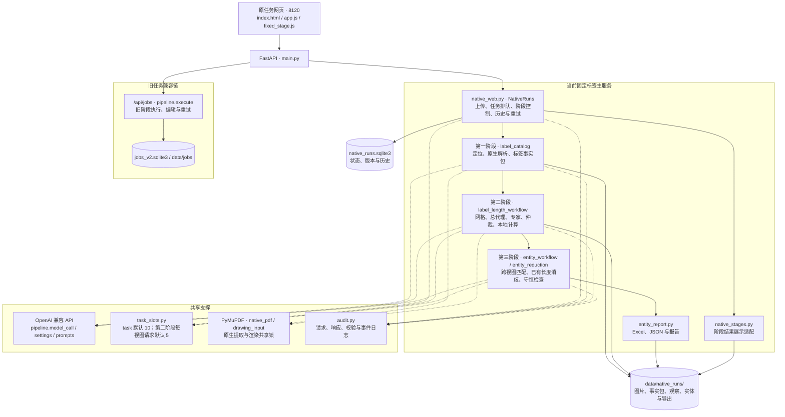
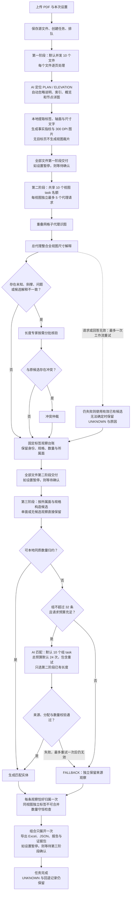

# 当前项目架构图与流程图

核对日期：2026-10-26；基于 `e8a3458` 的执行代码。图中并发数为默认值，可由环境变量或任务设置覆盖。模块详情见 [架构](architecture.md)，契约见各阶段文档。

## 架构图

实线表示主要调用或数据交付，虚线表示共享支撑能力。旧任务兼容链继续存在，其数据结构与固定标签新链独立。

第一阶段交付 `stage_one_facts.json` 与 300 DPI 图像；第二阶段交付 `stage_two.json` 的固定标签长度台账；第三阶段交付 `stage_three.json`、单根汇总与证据导出。各阶段产物和历史独立保存，两个任务数据库不自动迁移或混用。

## 流程图

主路径为新 PDF 上传后自动完成三阶段。阶段间有交付屏障；启用暂停时，须在相应阶段完成后确认才继续。第二阶段的候选均经原生文字引用与本地算术校验。

图中重试框以总代理为示例：第二阶段子代理、总代理、专家和仲裁请求均适用格式/传输重试规则；第三阶段重试还受总预算约束。原生提取与渲染加锁，API 等待不占该锁。

失败/中断后须显式重试，可复用签名校验通过的已有响应；已完成任务从第二阶段重跑时保留第一阶段，使下游当前结果失效并保留历史。服务重启不自动恢复付费运行。

completed 表示流程结束与结果可导出；请求失败可能转换为 UNKNOWN 或 FALLBACK。第一阶段目前只有 AI 自动过滤，网页没有手动排除页面、视图或规格的入口。输出为图示名义长度，非加工下料长度；UNKNOWN 为零与数量守恒都不能证明工程准确率。
